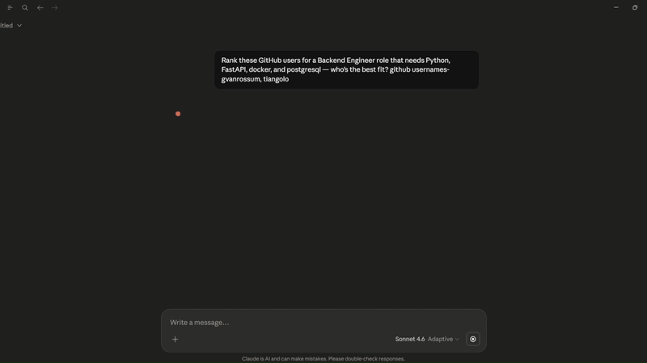

# github-ranker-remote-mcp-server

A remote MCP server built with FastMCP that ranks GitHub candidates against a job's required skills.

## What it does

Give it a list of GitHub usernames, a job title, and required skills — it fetches each profile from the GitHub API, scores them by skill match (languages + repo topics), and returns ranked candidate data. A prompt primitive is included for the MCP client's LLM to format the output as a markdown report.

## Demo



## Primitives

| Primitive | Name | Description |
|---|---|---|
| `@mcp.tool` | `rank_candidates` | Fetches GitHub profiles, scores each against required skills, returns ranked JSON |
| `@mcp.prompt` | `ranking_report` | Takes the tool output and returns a prompt for the client LLM to generate a markdown report |

## Connecting

Go to Claude.ai → Settings → Customize → Add MCP Server → paste:

```
https://github-ranker-remote-mcp-server.onrender.com/mcp
```

> **Note:** Hosted on Render's free tier — first request after 15 min idle takes ~30s to wake up.

## Usage

Once connected, call the tool with:

- `usernames` — list of GitHub usernames
- `job_title` — role being hired for
- `skills` — comma-separated, using GitHub language names (`Python`, `Go`, `TypeScript`) and lowercase repo topic keywords (`docker`, `fastapi`, `kubernetes`)

Skills are matched against each user's top languages and repo topic tags.

Then pass the output into the `ranking_report` prompt — the client LLM generates the final markdown report. No external API call is made from the server.

## Stack

- [FastMCP](https://gofastmcp.com) — MCP server framework
- [httpx](https://www.python-httpx.org) — async GitHub API calls
- Python 3.11+
- Deployed on [Render](https://render.com)

## Running locally

```bash
uv init
uv add fastmcp httpx
```

Create a `.env` file:
```
GITHUB_TOKEN=your_token_here
```

```bash
uv run python server.py
```

Server starts on `http://0.0.0.0:8000/mcp`.

### Development / testing

```bash
uv run fastmcp dev inspector --server-spec server.py
```

Opens the MCP Inspector UI for interactive tool testing.